<!-- Created by The Angelo Umali. -->

# ZKidz Studio

**Drop in your footage, say what you want, and watch Claude edit it on your own computer.**

<p align="center">
  <a href="https://theangeloumali.github.io/zkidz-studio/">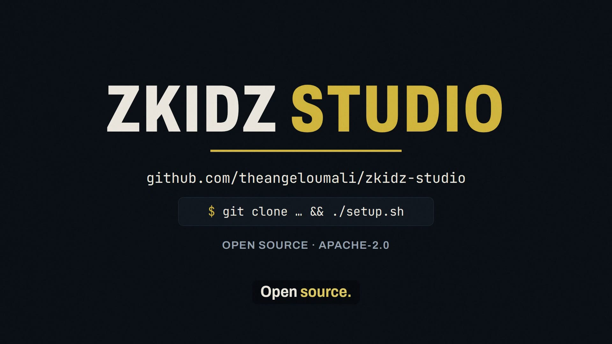</a>
</p>

<p align="center">
  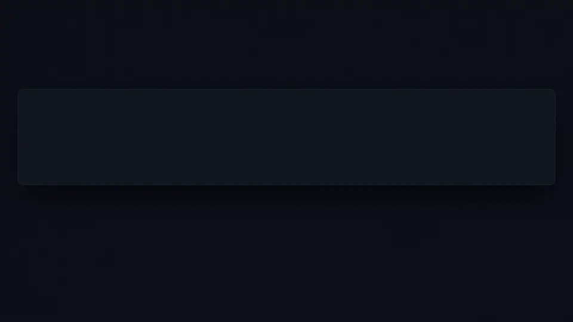
</p>

[Website](https://theangeloumali.github.io/zkidz-studio/) · [Docs](docs/user/README.md) · [Install](#install)

ZKidz Studio is a local-first desktop app for short-form video. Your footage stays on your computer; the only outside traffic is
the calls to Claude and setup's downloads.

ZKidz Studio is not affiliated with, endorsed by, or sponsored by Anthropic.

## What it does

- **Footage plus a prompt.** Drop in clips, type what you want, and the agent plans the edit.
- **Live cuts.** Claude cuts pauses and retakes, and every change lands in the preview and timeline as it happens.
- **Captions, titles, overlays and sound.** Captions, titles, animated overlays and sound effects sit on their own timeline tracks.
- **Versions.** Every spec the agent writes is a saved version; restore an older one at any time.
- **11 quality checks on the export**, including `cutWords`, `hookMouth`, `lipSync`, `captionContrast` and `loudness`. Only a master
  that passed is exported.
- **Deliverables.** A 4K master (on the `nvidia` backend; other backends make 1080), the Reels cut and covers, each file
  listed with its SHA-256.
- **Local-first, bring your own Claude.** Use an API key, your cloud, or your installed Claude Code.

## How it works

```text
 you ──> prompt ──> Claude (Claude Code or the Agent SDK)
                         │
                         ▼
                 studio tools (MCP)
                         │
                         ▼
        engine: ffmpeg · whisper.cpp · HyperFrames
                         │
        ┌────────────┬───┴────────┬────────────┐
        ▼            ▼            ▼            ▼
   live preview   timeline        QC        export
```

## Showcase

The studio's engine grew out of a private editing pipeline that has delivered 40+ edits for the ZKidz Dev channel. These covers
came from it.

<table>
  <tr>
    <td align="center"><a href="https://www.youtube.com/@theangeloumali">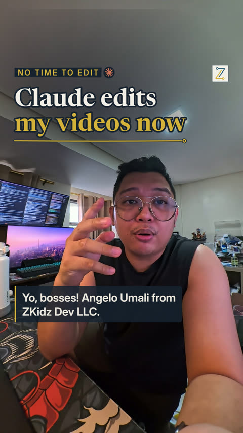</a><br>Claude edits my videos now</td>
    <td align="center"><a href="https://www.youtube.com/@theangeloumali">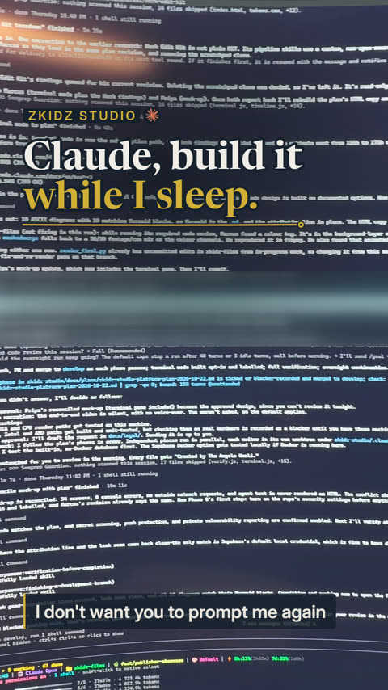</a><br>Building ZKidz Studio in the open</td>
    <td align="center"><a href="https://www.youtube.com/@theangeloumali">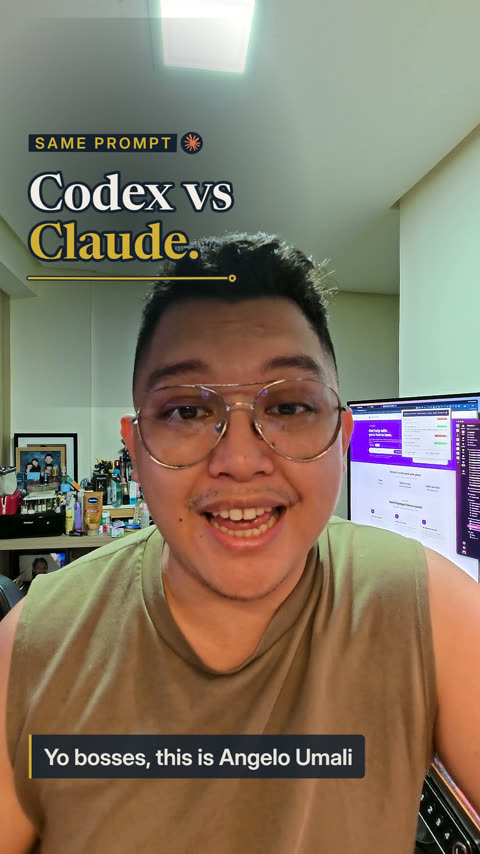</a><br>Codex vs Claude Opus 5.5</td>
    <td align="center"><a href="https://www.youtube.com/@theangeloumali">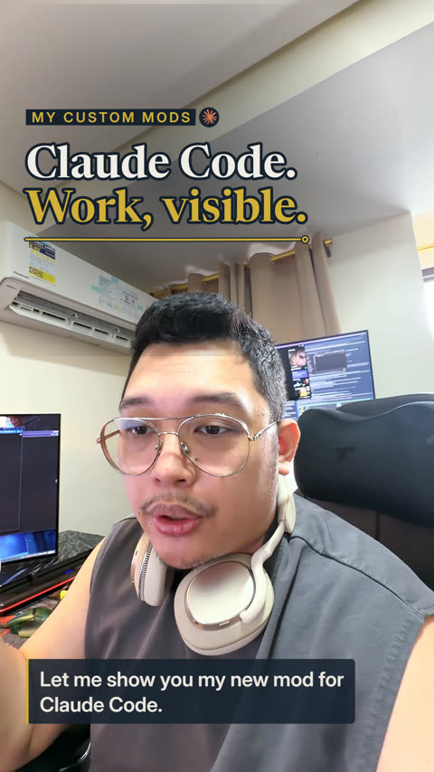</a><br>Claude Code mods</td>
  </tr>
  <tr>
    <td align="center"><a href="https://www.youtube.com/@theangeloumali">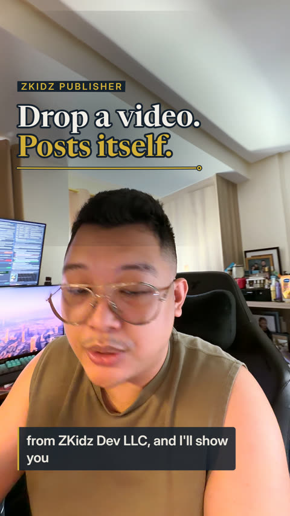</a><br>ZKidz Publisher</td>
    <td align="center"><a href="https://www.youtube.com/@theangeloumali">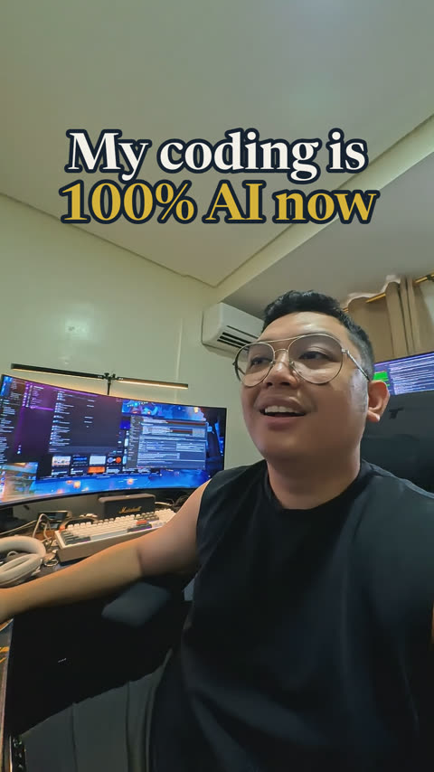</a><br>My coding is 100% AI now</td>
    <td align="center"><a href="https://www.youtube.com/@theangeloumali">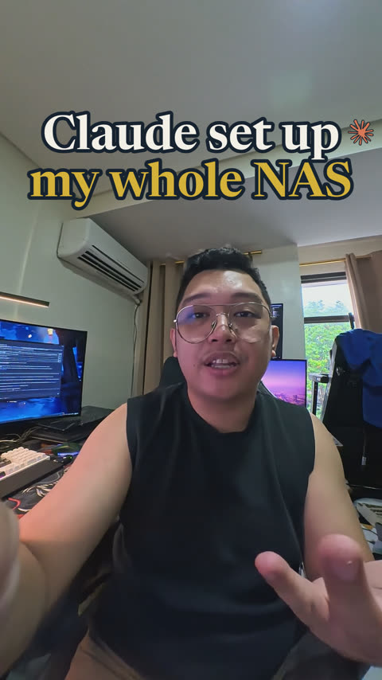</a><br>Claude set up my whole NAS</td>
    <td align="center"><a href="https://www.youtube.com/@theangeloumali">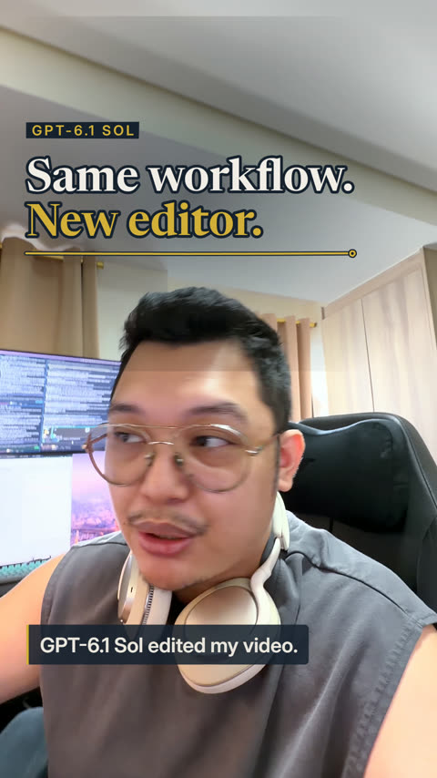</a><br>GPT-6.1 Sol as an alternative video editor</td>
  </tr>
  <tr>
    <td align="center"><a href="https://www.youtube.com/@theangeloumali">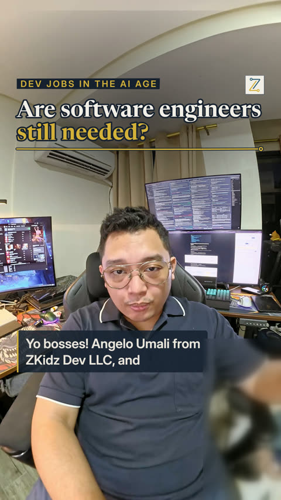</a><br>Are software engineers still needed?</td>
    <td align="center"><a href="https://www.youtube.com/@theangeloumali">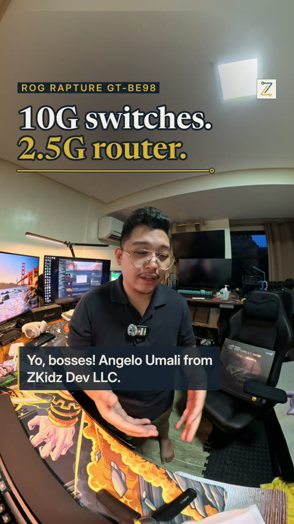</a><br>ROG Rapture GT-BE98 unboxing</td>
    <td align="center"><a href="https://www.youtube.com/@theangeloumali">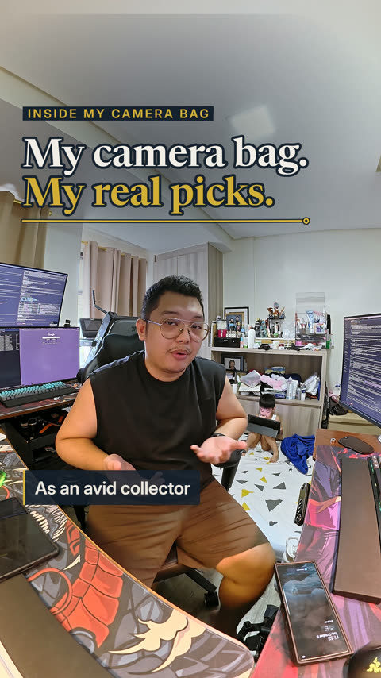</a><br>Inside my camera bag</td>
    <td align="center"><a href="https://www.youtube.com/@theangeloumali">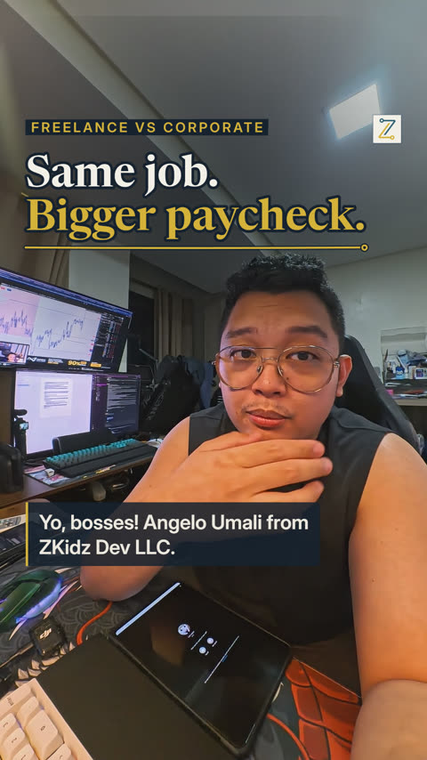</a><br>How to start a freelance career</td>
  </tr>
</table>

### Edited in ZKidz Studio

<table>
  <tr>
    <td align="center"><a href="https://www.youtube.com/@theangeloumali">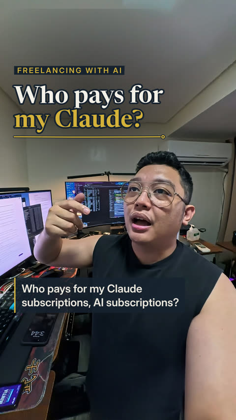</a></td>
    <td align="center"><a href="https://www.youtube.com/@theangeloumali">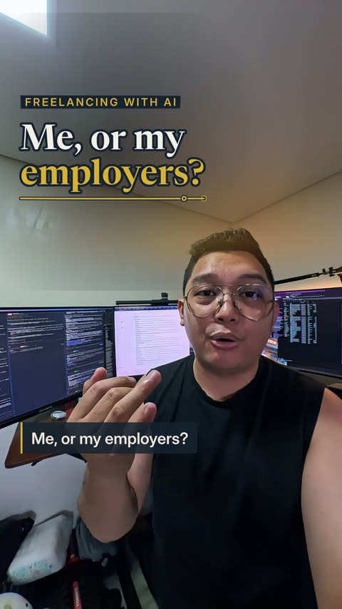</a></td>
  </tr>
</table>

The studio's first real edit: a 4K master and a Reels cut that passed all 11 checks, made by Claude in terminal mode.

## Requirements

- Linux x64 or arm64, macOS on Apple silicon, or Windows 10/11 (x64 or arm64). WSL works; keep the repo and your media in the
  Linux home, not under `/mnt`.
- 20 GB of free disk for tools, models and renders.
- `git` and `curl`. Setup downloads everything else (Node, pnpm, uv, Python, ffmpeg, Chrome, whisper models) into the app's data
  folder and checks each download's SHA-256.
- A GPU is optional. Every feature has a CPU path; see [Hardware](#hardware).
- One way to reach Claude: an API key, a cloud provider, or an installed Claude Code (see [Connect Claude](#connect-claude)).

## Install

One command per OS. It installs the pinned tools, runs `zks setup`, then starts the app.

```bash
# macOS, Linux, WSL
git clone https://github.com/theangeloumali/zkidz-studio && cd zkidz-studio && ./setup.sh
```

```powershell
# Windows (PowerShell); setup.cmd does the same from cmd.exe
git clone https://github.com/theangeloumali/zkidz-studio; cd zkidz-studio
powershell -ExecutionPolicy Bypass -File .\setup.ps1
```

Already have pnpm? `pnpm install --frozen-lockfile && pnpm zks setup`. Pass `--no-start` to any setup script to stop before
the server starts. Setup is safe to re-run: it downloads only what is missing.

### Docker

```bash
docker compose -f docker/compose.yml up -d --build                          # CPU
docker compose -f docker/compose.yml --profile nvidia up -d --build studio-nvidia   # NVIDIA GPU
```

The image is built locally from your checkout and never pushed. Compose publishes only `127.0.0.1:4317`, and your projects and API
key live in the `zks-home` volume. Mode T is not available in the container. Details: [docs/user/docker.md](docs/user/docker.md).

## Run

```bash
pnpm start
```

Open <http://127.0.0.1:4317>. The server listens on loopback only.

## Connect Claude

The Connect Claude screen offers three modes. Pick one; you can switch later.

| Mode | You bring                                          | Who pays                  | Label in the app                    |
| ---- | -------------------------------------------------- | ------------------------- | ----------------------------------- |
| A    | A Claude Console API key                           | Your Console account      | Recommended                         |
| B    | Your own Bedrock, Vertex, Foundry or Claude on AWS | Your cloud account        | Advanced                            |
| T    | Claude Code installed on this computer, signed in  | Your Claude plan's limits | Opt-in · pending Anthropic approval |

- Mode A stores the key in your OS keychain and only ever shows its last four characters. The app estimates cost per turn; your
  Console usage page is the real bill.
- Mode B uses your cloud CLI's own sign-in. The app stores no cloud secret.
- Mode T (terminal mode) is off until you turn it on. It runs the `claude` program you installed, unmodified, in a terminal pane
  in the Editor. You sign in there with its own `/login`; the app never sees your credentials. The first time you open a project,
  Claude Code asks whether you trust the folder: choose "Yes, I trust this folder" (the highlighted default exits). We have asked
  Anthropic for written approval of this mode; if the answer is no, mode T is removed and modes A and B keep working.

The app never offers "Sign in with Claude" and never accepts a pasted token or credential file. Full details:
[docs/user/claude-access.md](docs/user/claude-access.md).

## Your first edit

No footage needed. On Home, choose **Try the demo project**. The app generates a 6-second test clip, applies a ready-made cut and
cue sheet, renders it, and opens the result in the Editor. Then try a template (talking-head short, vlog or screen-recording
showcase) with your own clips. Walkthrough: [docs/user/getting-started.md](docs/user/getting-started.md).

## Database

The built-in database (PGlite) needs no setup. To use a local Supabase Postgres instead, start it and point `DATABASE_URL` at it:

```bash
pnpm db:supabase:start                    # Postgres on 127.0.0.1:45322, password generated per install
export DATABASE_URL=$(pnpm --silent db:supabase:url)
pnpm start
```

`pnpm db:supabase:stop`, `db:supabase:studio` (the Supabase Studio UI, behind a generated password), `db:backup`, `db:restore`,
`db:reset` and `db:rollback -- --to <NNNN>` manage it; every command that changes data writes a backup first. The
`db:supabase:*` commands need Docker; the others run on whichever database `DATABASE_URL` selects.

## Hardware

`pnpm zks doctor` probes each video backend by encoding real frames, then uses the first one that works, in this order:

| Backend        | Hardware                 | Status                                                        |
| -------------- | ------------------------ | ------------------------------------------------------------- |
| `nvidia`       | NVIDIA GPU (NVENC/NVDEC) | Verified on the maintainer's RTX machine (`pnpm verify:gpu`)  |
| `videotoolbox` | Apple silicon Mac        | Filter graph unit-tested; not yet verified on hardware        |
| `qsv`          | Intel Quick Sync         | Filter graph unit-tested; not yet verified on hardware        |
| `amf`          | AMD on Windows           | Filter graph unit-tested; not yet verified on hardware        |
| `vaapi`        | AMD or Intel on Linux    | Filter graph unit-tested; not yet verified on hardware        |
| `cpu`          | Any machine              | Golden render in the test suite. 4K is slow; 1080p is offered |

A pull request that changes an unverified backend carries the `gpu-needed` label until someone checks it on real hardware.

## Documentation

Full guide: [docs/user](docs/user/README.md). Website: <https://theangeloumali.github.io/zkidz-studio/>.

- [Getting started](docs/user/getting-started.md)
- [Connecting Claude](docs/user/claude-access.md)
- [The editor](docs/user/editor.md)
- [Templates and styles](docs/user/templates-and-styles.md)
- [Rules](docs/user/rules.md)
- [Render, covers, export and checks](docs/user/render-and-export.md)
- [Deliverables](docs/user/deliverables.md)
- [Troubleshooting with `zks doctor`](docs/user/troubleshooting.md)
- [Privacy and security](docs/user/privacy-and-security.md)
- [Docker](docs/user/docker.md)

## Project

[Contributing](CONTRIBUTING.md) · [Security](SECURITY.md) · [Code of conduct](CODE_OF_CONDUCT.md) · Apache-2.0
[licence](LICENSE) · [Trademarks](TRADEMARKS.md) · [Third-party notices](THIRD_PARTY.md)

Created by The Angelo Umali.
